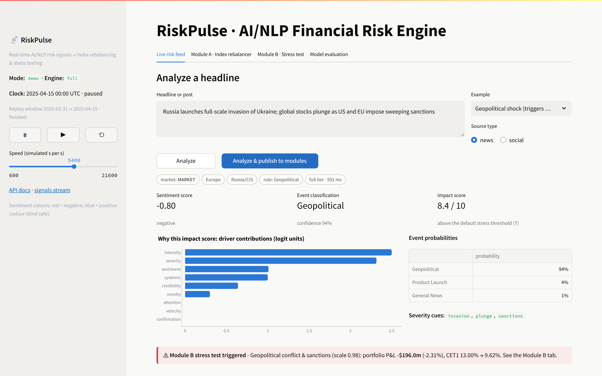
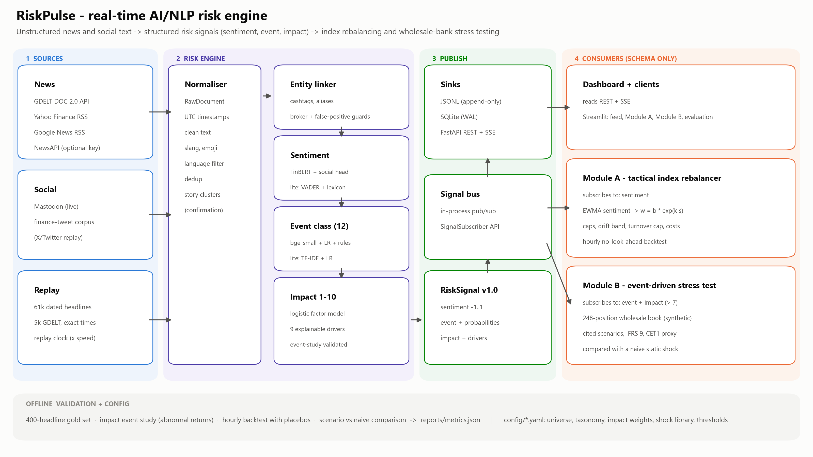
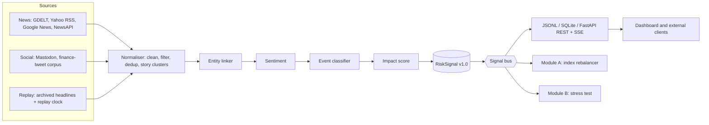
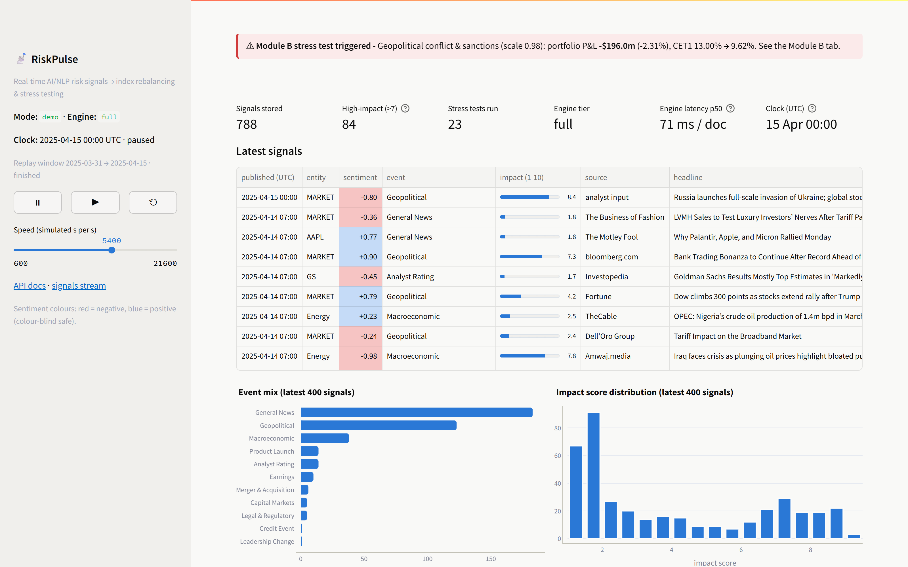
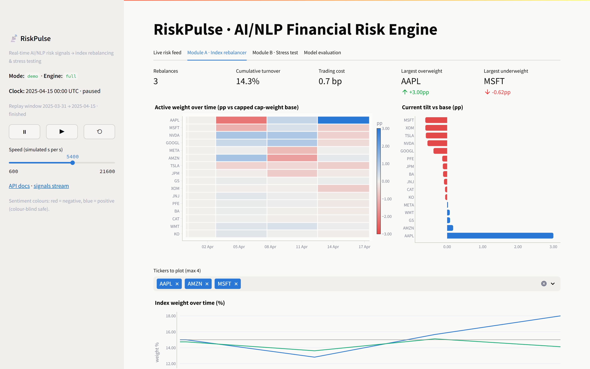
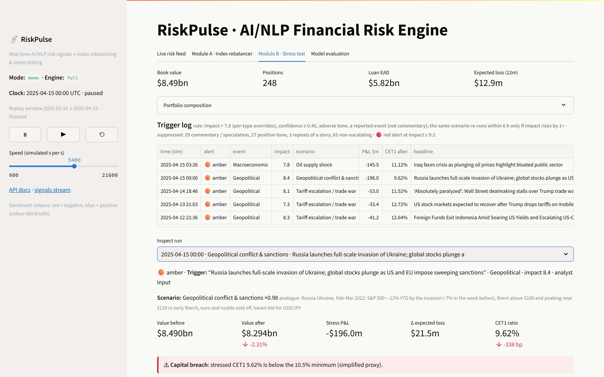
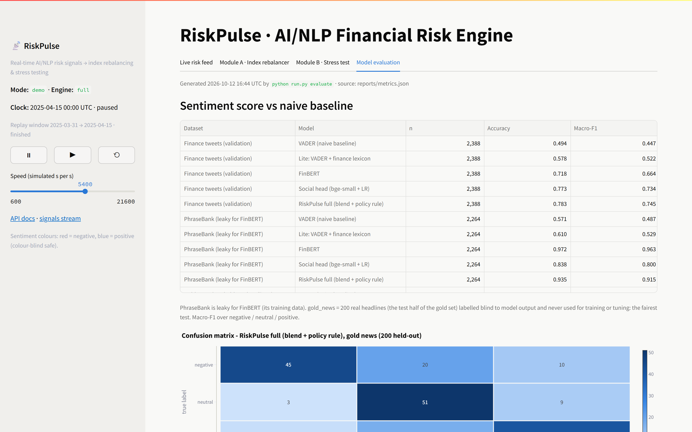
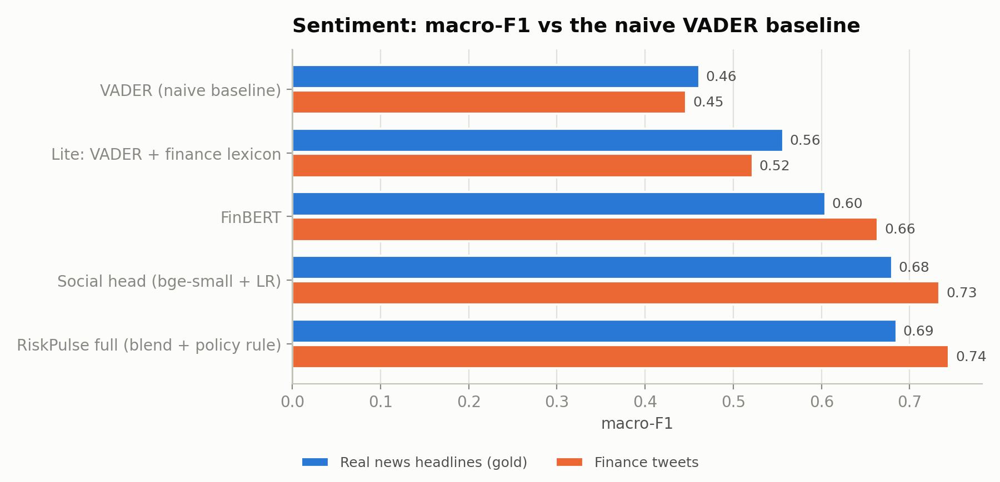
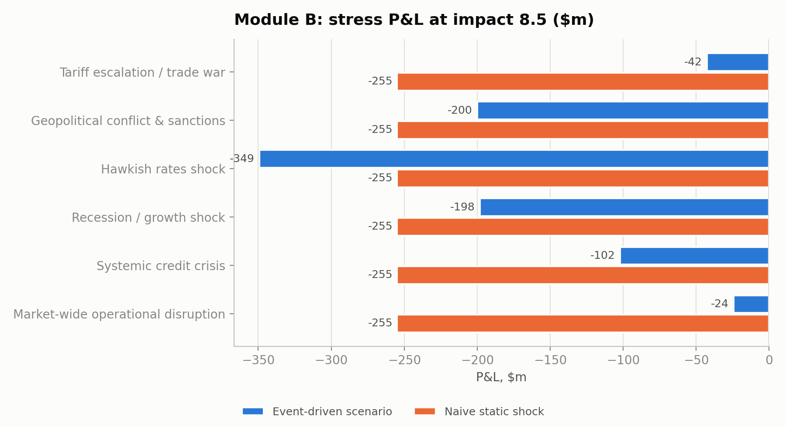

# RiskPulse: Real-Time AI/NLP Risk Engine - S&P Global & Crisil Campus Hackathon

**Candidate Name:** Anish Karthik Ayyagari
**College Email ID:** anishkarthik02.24@kgpian.iitkgp.ac.in
**College / Campus:** IIT Kharagpur
**Demo Video Link:** TODO (YouTube, unlisted)
**Slide Deck Link (if hosted externally):** [docs/presentation.pdf](docs/presentation.pdf) (in this repository)

## 1. Project Overview / Problem Statement & Approach

Markets move on news, but news arrives as free text: thousands of headlines and social posts a day. A
bank's risk desk cannot read and score all of it, and its stress tests usually run on a fixed schedule with
a fixed shock, whatever has actually happened. The problem is turning that stream into structured,
machine-readable risk signals fast enough to act on, and showing that downstream tools can use them.

RiskPulse is a unified AI/NLP risk engine. Connectors ingest **news** (GDELT, Yahoo Finance and Google News
RSS, optional NewsAPI) and **social posts** (Mastodon live, plus a replayed corpus of real finance tweets). A
normaliser cleans and deduplicates text into stories, an entity linker maps it to companies, sectors or the
market, and the engine emits a versioned `RiskSignal` with a **sentiment score** (-1 to 1, FinBERT blended
with a tweet-trained head), an **event classification** (12 risk types, an ensemble classifier plus
high-precision rules) and an **impact score** (1-10, an explainable logistic factor model whose drivers ship
with every signal). Signals go to an in-process bus, an append-only JSONL file, SQLite and a FastAPI REST +
Server-Sent Events API.

Two modules consume the signals through the schema only. **Module A** tilts a 16-stock S&P 100 index toward
positive sentiment within position, active-weight, drift and turnover limits. **Module B** fires an
event-specific stress test of a synthetic $8.5bn wholesale banking book when a high-impact event arrives,
and reports value before and after, P&L by risk factor, asset class and sector, IFRS 9 expected-loss
effects and a simplified CET1 impact, next to a naive static shock. Everything is measured against naive
baselines on held-out data, and weak results are reported as they are.



## 2. Architecture & Tech Stack





| Layer | Technology | Why |
|---|---|---|
| Ingestion | `requests`, `feedparser`; GDELT DOC 2.0, Yahoo/Google News RSS, Mastodon API, NewsAPI | Free sources, no keys needed by default; retries and rate-limit backoff |
| NLP (full tier) | FinBERT (`ProsusAI/finbert`), `BAAI/bge-small-en-v1.5` sentence embeddings, scikit-learn | Finance-domain sentiment; one embedding per document reused for dedup, events and the social head |
| NLP (lite tier) | VADER + finance lexicon, TF-IDF + logistic regression | Runs without torch on any laptop and in CI; automatic fallback |
| Signal transport | Pydantic schema, in-process bus, SQLite (WAL), JSONL | No external services; modules subscribe without importing engine code |
| API | FastAPI + `sse-starlette` (interactive docs at `/docs`) | REST queries, live SSE stream, `POST /analyze` |
| Dashboard | Streamlit + Plotly (colour-blind-safe palette) | Four tabs: live feed, Module A, Module B, evaluation |
| Evaluation | pandas, SciPy, matplotlib | One command regenerates every number and chart |

## 3. Dataset Used

All data is in [`data/`](data/) and described in the **[data card](data/README.md)** (source, licence, script,
size, real or synthetic). Nothing is proprietary or taken from S&P Global or Crisil: every connector drops
items they publish (46 S&P Global articles that Google News had indexed were removed from the archive), while
third-party news that only mentions them, such as a reported rating action, is kept.

| Data | Type | Use |
|---|---|---|
| 21k finance tweets with topic labels, 12k with sentiment labels (zeroshot, MIT) | Real, public | Training (weak supervision) and validation |
| Financial PhraseBank AllAgree, 2,264 sentences (CC BY-NC-SA 3.0) | Real, public | Evaluation only |
| 61,399 dated headlines, Oct 2024 - Oct 2026 (Google News RSS) + 5,269 GDELT headlines | Real, public | Replay, backtest, event study, gold set |
| 400 real headlines labelled for event and sentiment (200 dev / 200 test) | Real text, labelled for this project | Domain adaptation (dev) and evaluation (test) |
| Daily and hourly prices for the 16 stocks, SPY, ^TNX, ^VIX, oil, credit ETFs (yfinance) | Real, public | Backtest, event study, scenario calibration |
| Wholesale trade blotter: 671 trades, 248 positions, 120 counterparties | **Synthetic**, seeded | Module B portfolio |
| 85 headlines about fictional companies | **Synthetic** | Training only, for rare risk classes |

Key assumptions: about 97% of archive headlines carry a date but no time, so a headline is treated as
usable only after its day ends; corpus tweets have no timestamps and are never used in the backtest; loans
go to fictional borrowers while bonds, CDS and equities reference public issuers; spreads, PDs and LGDs are
typical long-run levels and risk weights follow Basel CRE20. The case-study pack suggested retail transaction
datasets (Salad Money open banking, Kaggle card transactions); they describe consumer spending, not a wholesale
book of loans, bonds and derivatives, so Module B uses a synthetic wholesale trade blotter instead.

## 4. Quickstart & Installation

Runtime: **Python 3.11 or 3.12** on Windows 11 (developed on Python 3.12.7; CI runs the lite tier on Ubuntu,
Python 3.11). Python 3.13 is not supported: the pinned numpy, pandas and scikit-learn have no 3.13 wheels.

```bash
git clone https://github.com/Realmer01/iitkgp-anish-karthik-ayyagari-hackathon.git
cd iitkgp-anish-karthik-ayyagari-hackathon
python -m venv .venv              # Python 3.11 or 3.12, e.g. `py -3.12 -m venv .venv` on Windows
.venv\Scripts\activate            # macOS / Linux: source .venv/bin/activate
pip install -r requirements.txt
python run.py demo
```

`python run.py demo` starts the API and the dashboard and opens http://localhost:8501. It runs **offline**:
it replays precomputed signals for the April 2025 US tariff shock through the live modules, and loads the
NLP engine for the "Analyze a headline" box. The first run downloads FinBERT and bge-small
from Hugging Face (about 0.6 GB) and caches them.

| Command | What it does |
|---|---|
| `python run.py demo` | Offline demo: API + dashboard, replay of precomputed signals |
| `python run.py demo --tier lite` | Same, without torch (`pip install -r requirements-lite.txt` is enough) |
| `python run.py api` | API only (`--mode demo\|replay\|live`) |
| `python run.py replay --speed 3600` | Stream archived headlines through the live engine (simulated seconds per second) |
| `python run.py live` | Poll live news and social sources |
| `python run.py evaluate` | Regenerate `reports/metrics.json` and the charts in `docs/images/` (~20 min) |
| `pytest` | Run the test suite |

<details>
<summary><b>Dashboard screenshots</b> (all four tabs, after the April 2025 replay)</summary>






</details>

## 5. Key Results & Domain Impact

Every number below is generated from [`reports/metrics.json`](reports/metrics.json) by
`python run.py evaluate`.

<!-- results:start -->
| Result | RiskPulse | Naive baseline | Data |
|---|---|---|---|
| Sentiment, macro-F1 on held-out real headlines | **0.69** | 0.46 (VADER) | 200 gold test headlines |
| Sentiment, macro-F1 on finance tweets | **0.74** | 0.45 (VADER) | 2,388 validation tweets |
| Event classification, macro-F1 (accuracy) on held-out real headlines | **0.65** (0.76) | 0.51 (0.60) keyword rules | 200 gold test headlines |
| Impact vs the S&P 500's own move, market-wide news (Spearman) | **0.088** | 0.027 (\|sentiment\|) | 491 days |
| Impact vs single-stock abnormal move (Spearman) | 0.122 | **0.149** (\|sentiment\|) | 6,564 company-days |
| Stress tests: rates P&L with the wrong sign | **0 of 6** | 4 of 6 (static shock) | 6 scenarios at impact 8.5 |
| Headline to stress-test result | **0.25 s** | overnight batch (assumed) | laptop CPU |
| Module A active return vs the same rules without sentiment | -0.62% / yr (IC -0.004) | +0.03% / yr (lexicon tilt) | hourly, Oct 2024 - Oct 2026, 5 bp costs |
| Engine throughput | 28.1 docs/s full, 670.0 docs/s lite | - | CPU only |

Bold marks the better score. In the April 2025 tariff-shock replay, 22 stress tests fired from 146 signals above the threshold: 29 were skipped as commentary or speculation, 27 as positive news, and the rest were repeats of a story or not escalating. The highest-impact run (impact 9.5) came from "Global markets in turmoil as Trump tariffs wipe $2.5tn off Wall Street" and routed to *Tariff escalation / trade war*: P&L -$121.1m, CET1 9.77%.
Two results are deliberately reported as they are: |sentiment| alone ranks single-stock moves slightly better than the composite impact score, and sentiment tilts show no reliable edge once timing is strict (an early backtest showing IR 3.7 was a look-ahead leak, traced and fixed). A risk test fixed in advance agrees: on the 23 days the S&P 500 fell more than 1.5%, the tilt's active return was -1.2 bp a day (t = -0.5); after high-impact negative company news it was 1.0 points underweight in stocks that lagged the S&P 500 by 11 bp the next day - the right direction, but far too small to change the overall result.
<!-- results:end -->




**Why it matters**

- **Faster, event-aware stress testing.** A headline becomes a scenario-specific stress result in well under
  a second, instead of waiting for a scheduled run with a generic shock. The naive shock books rate losses in
  flight-to-quality events where yields actually fall.
- **Capital view, not just P&L.** IFRS 9 staging and a Basel-style capital proxy show when an event would
  push CET1 below its minimum, which is the question a bank's risk committee asks.
- **Explainable and governable.** Every signal carries its drivers, schema version and model version, so a
  model-risk team can audit any score; thresholds live in configuration (see the
  [model card](docs/model_card.md)).
- **Honest evidence.** Sentiment and event models beat naive baselines on held-out real headlines; the impact
  score tracks market-wide moves; and the backtest shows no reliable trading edge once timing is strict.
  Knowing what does not work is part of risk management.

## Signal schema and API

Each `RiskSignal` (see [`src/riskpulse/schema.py`](src/riskpulse/schema.py)):

<!-- example:start -->
```json
{
  "signal_id": "e5b9c193e1f90662",
  "schema_version": "1.0",
  "published_at": "2025-04-03T07:00:00Z",
  "source": "google_news",
  "source_type": "news",
  "publisher": "The Guardian",
  "headline": "Global markets in turmoil as Trump tariffs wipe $2.5tn off Wall Street",
  "entity": {
    "type": "market",
    "id": "MARKET",
    "name": "Broad market",
    "ticker": null,
    "sector": null,
    "country": null,
    "matched": "Global markets"
  },
  "sentiment_score": -0.9434,
  "sentiment_label": "negative",
  "sentiment_confidence": 0.9534,
  "event_type": "Geopolitical",
  "event_confidence": 0.9365,
  "impact_score": 9.5,
  "mention_count": 1,
  "sources": [
    "The Guardian"
  ],
  "model_tier": "full",
  "event_probs": {
    "Geopolitical": 0.9365,
    "General News": 0.0363,
    "Macroeconomic": 0.0089
  },
  "impact_drivers": {
    "contributions": {
      "severity": 2.3049,
      "sentiment": 1.3491,
      "intensity": 2.5,
      "systemic": 1.0,
      "confirmation": 0.0,
      "velocity": 0.0,
      "attention": 0.9765,
      "credibility": 0.64,
      "novelty": 0.3
    },
    "logit": 2.8005,
    "cues": [
      "$2.5tn",
      "turmoil",
      "tariffs"
    ]
  }
}
```

(A real signal from the demo data, abridged.)
<!-- example:end -->

```bash
curl "http://127.0.0.1:8000/signals?min_impact=7&limit=5"            # filter: ticker, event_type, min_impact, since
curl "http://127.0.0.1:8000/signals/latest/NVDA"
curl "http://127.0.0.1:8000/entities/AAPL/sentiment"                  # EWMA sentiment, confidence and impact weighted
curl -N "http://127.0.0.1:8000/stream"                                # Server-Sent Events
curl -X POST "http://127.0.0.1:8000/analyze" -H "Content-Type: application/json" \
     -d '{"text": "Boeing files for Chapter 11 bankruptcy protection", "inject": true}'
curl -X POST "http://127.0.0.1:8000/module-b/what-if" -H "Content-Type: application/json" \
     -d '{"event_type": "Geopolitical", "impact": 8.5, "headline": "New tariffs on Chinese imports"}'
```

The same signals are appended to `runtime/signals.jsonl` for file-based consumers.

## Module A: tactical index rebalancer

- **Universe:** 16 S&P 100 constituents across 8 sectors (`config/universe.yaml`); base weights are market
  capitalisation, capped at 15% and floored at 1%.
- **Signal:** per-stock sentiment is an exponentially decayed (12-hour half-life), evidence-weighted average,
  shrunk toward zero so one post cannot swing a name; follow-ups of the same story count less.
- **Weights:** `w ∝ base · exp(κ·s)` with κ = 0.8, then per-stock bounds (0.5%-18%), a 4-point active-weight
  limit, a drift band of min(50 bp, 25% of base weight), a 10% turnover cap and 5 bp costs.
- **Backtest:** hourly bars, open-to-open returns, a signal only affects bars that start after it is
  available; compared with the same rules at κ = 0, static cap-weight and equal weight; placebo and delay
  tests; κ × half-life sensitivity grid.

## Module B: strategic stress test

- **Book:** a seeded trade blotter (`scripts/generate_portfolio.py`) aggregated into term loans, revolvers,
  trade finance, sovereign and corporate bonds, interest-rate swaps, single-name and index CDS, FX forwards,
  listed equity, equity TRS, index puts, an index future and an oil swap.
- **Trigger:** stress-eligible event with impact above 7 (per-type thresholds) and confidence ≥ 0.45 that
  reports an adverse event: positive-tone news (a de-escalation) and commentary (questions, explainers,
  listicles, hedged speculation, detected by `nlp/framing.py`) are skipped and counted. Story dedup; the same
  scenario re-runs within 6 hours only if impact rises by at least 1 point. `POST /analyze` says why a
  headline did not trigger.
- **Alert level:** every run is amber or red. Red means the trigger's impact is at least 9.2, a threshold set
  on the first year of the archive from alert frequency alone (red on at most 10% of days) and then tested on
  the second year against actual S&P 500 moves (results above).
- **Scenarios** (`config/shocks.yaml`): trade war, conflict and sanctions, hawkish rates, recession, oil
  shock, systemic credit, market-wide operational disruption, each loosely calibrated to a public episode
  ([references](docs/references.md)); scaled by impact (7 → 0.7×, 10 → 1.3×); targeted to the regions,
  sector and company named in the signal.
- **Revaluation:** bonds by duration and convexity, loans by IFRS 9 expected credit loss (lifetime ECL in
  Stage 2), swaps by DV01, CDS by CS01, FX and equity by delta, index puts by Black-Scholes repricing with a
  volatility response calibrated to April 2025.
- **Capital:** RWA from Basel CRE20 standardised weights, CET1 at 13% of baseline RWA, losses one-for-one,
  rating migration from stressed PDs. A simplified proxy, not a regulatory calculation.

## Repository structure

```
iitkgp-anish-karthik-ayyagari-hackathon/
├── README.md  LICENSE  requirements.txt  requirements-lite.txt  pyproject.toml  .env.example
├── run.py                      # single entry point (demo, api, replay, live, evaluate)
├── config/                     # settings, universe, taxonomy, impact weights, shock library
├── src/riskpulse/
│   ├── ingestion/  nlp/  engine/  bus/  api/      # the risk engine and its interfaces
│   ├── module_a/  module_b/                        # downstream modules (schema-only dependencies)
│   ├── dashboard/  evaluation/                     # Streamlit app, evaluation suite
│   └── schema.py  store.py  service.py  aggregate.py  universe.py  clock.py  config.py
├── scripts/                    # data fetchers, training, precompute, portfolio generator, docs builders
├── models/                     # small trained artefacts (logistic regressions, lexicon settings)
├── data/                       # every dataset used, with a data card
├── reports/                    # metrics.json and CSVs written by `python run.py evaluate`
├── docs/                       # presentation, architecture diagram, model card, references, images
└── tests/                      # pytest suite (lite tier)
```

## Testing

```bash
pytest                       # schema ranges, entity-linking edge cases, impact monotonicity, Module A
                             # constraints and no-look-ahead, Module B bond maths and trigger rules, API
ruff check src scripts tests run.py
```

CI ([`.github/workflows/ci.yml`](.github/workflows/ci.yml)) installs the lite tier on Python 3.11, lints,
runs the tests and a quick evaluation.

## Limitations and next steps

- Most archive headlines carry dates, not times, so historical tests are day-level; intraday timestamped
  feeds are the next step for testing fast reactions.
- 16 mega-cap names over two years: a small, survivorship-biased sample.
- Gold labels come from a single annotator (AI-proposed, reviewed by the author); a second annotator would measure agreement.
- English only; multilingual encoders and translation are natural extensions.
- Module B uses sensitivity-based revaluation and a simplified capital proxy; production would use a full
  pricing library and regulatory scenarios.
- The automatic stress trigger runs on about 90% of trading days, so on its own it does not single out
  volatile days; the red-alert tier does, modestly, but fired on 24% of days in its test year against a 10%
  target, so its threshold needs regular recalibration.
- GDELT's free API throttles heavily (HTTP 429); live mode counts and skips it until the next poll.
- Production hardening: Kafka for the bus, a feature store for entity state, a model registry and
  drift monitoring (see the [model card](docs/model_card.md)).

## AI Assistance Disclosure

This project was built with extensive help from an AI coding assistant (Claude, by Anthropic, used through
Claude Code), as the hackathon rules allow. I wrote the requirements and build plan, made the scope and data
decisions (both modules, public and synthetic data only, what to publish), reviewed the results and decided
how to report them. The assistant generated most of the code, tests and documentation, looked up public
sources used for calibration, and proposed the gold-set labels, which I reviewed; all labels were assigned blind to model output.
All reported numbers are produced by the scripts in this repository and can be regenerated with
`python run.py evaluate`. No AI-generated text is presented as real data: the only synthetic text (85 seed
headlines about fictional companies) and the synthetic portfolio are labelled as such.

## Licences and acknowledgements

- Code: MIT ([LICENSE](LICENSE)).
- Models: FinBERT ([ProsusAI/finbert](https://huggingface.co/ProsusAI/finbert)), bge-small-en-v1.5
  ([BAAI](https://huggingface.co/BAAI/bge-small-en-v1.5)), VADER (Hutto & Gilbert, 2014).
- Datasets: zeroshot twitter-financial-news topic and sentiment (MIT); Financial PhraseBank (Malo et al.,
  2014, CC BY-NC-SA 3.0); GDELT Project; Google News and Yahoo Finance RSS headlines (titles credited to their
  publishers); Yahoo Finance prices via yfinance.
- Regulatory and market references: [docs/references.md](docs/references.md).
